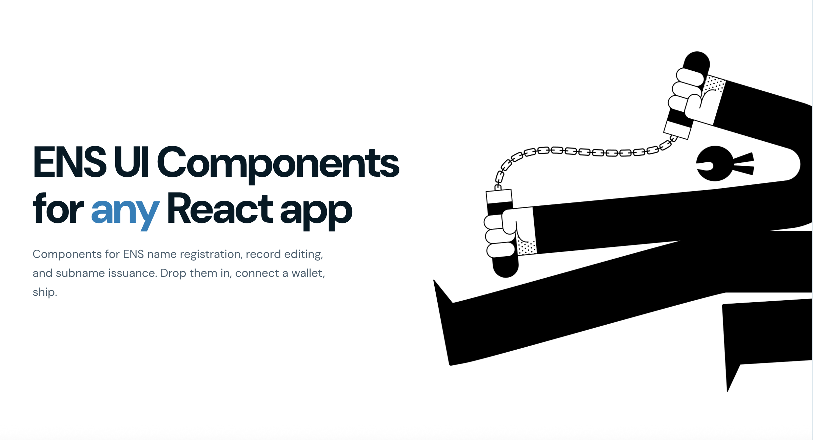

# ENS Components

**Drop-in React components for ENS name registration, renewal, record editing, and subname issuance on ENSv2.**

[](https://www.npmjs.com/package/@thenamespace/ens-components)
[](LICENSE)
[](https://github.com/thenamespace/ens-components/actions/workflows/checks.yaml)

[npm](https://www.npmjs.com/package/@thenamespace/ens-components) · [Playground](https://enscomponents.com) · [Component reference](packages/components/README.md#components) · [Releases](https://github.com/thenamespace/ens-components/releases)



## What's included

| Component                                  | What it does                                                                    |
| ------------------------------------------ | ------------------------------------------------------------------------------- |
| `EnsNameRegistrationForm`                  | Register a `.eth` name — search, commit, wait, register. Paid in USDC or DAI    |
| `NameRenewForm`                            | Renew a `.eth` name in USDC or DAI                                              |
| `EnsRecordsForm`                           | Edit resolver records (addresses, text, contenthash, avatar) for a name you own |
| `SelectRecordsForm`                        | Standalone record composer — no wallet or transaction required                  |
| `SubnameMintForm`                          | Mint onchain subnames under a name activated on Namespace                       |
| `SubnameRenewForm`                         | Renew onchain subnames                                                          |
| `OffchainSubnameForm`                      | Create and update gasless offchain subnames via the Namespace API               |
| `TransactionProgress` / `TransactionModal` | The progress screen the forms use, available for your own transactions          |

## Quick start

Requires React 19+, wagmi 2, viem 2, and TanStack Query 5. This example uses
RainbowKit for wallet connection in a client-rendered React app.

```sh
pnpm add @thenamespace/ens-components react@^19 react-dom@^19 wagmi@^2.19.5 viem@^2.46.3 @tanstack/react-query@^5 @rainbow-me/rainbowkit@^2.2.8
```

Create a WalletConnect project ID at [Reown](https://cloud.reown.com), replace
`YOUR_WALLETCONNECT_PROJECT_ID`, and render this `App` in your React application:

```tsx
"use client";

import { useState } from "react";
import {
  ConnectButton,
  getDefaultConfig,
  RainbowKitProvider,
  useConnectModal,
} from "@rainbow-me/rainbowkit";
import { QueryClient, QueryClientProvider } from "@tanstack/react-query";
import { WagmiProvider } from "wagmi";
import { sepolia } from "wagmi/chains";
import { EnsNameRegistrationForm } from "@thenamespace/ens-components";
import "@rainbow-me/rainbowkit/styles.css";
import "@thenamespace/ens-components/styles.css";

const config = getDefaultConfig({
  appName: "My ENS App",
  projectId: "YOUR_WALLETCONNECT_PROJECT_ID",
  chains: [sepolia],
});

function RegisterName() {
  const { openConnectModal } = useConnectModal();
  return (
    <>
      <ConnectButton />
      <EnsNameRegistrationForm isTestnet onConnectWallet={openConnectModal} />
    </>
  );
}

export default function App() {
  const [queryClient] = useState(() => new QueryClient());
  return (
    <WagmiProvider config={config}>
      <QueryClientProvider client={queryClient}>
        <RainbowKitProvider>
          <RegisterName />
        </RainbowKitProvider>
      </QueryClientProvider>
    </WagmiProvider>
  );
}
```

This example uses Sepolia. Registration needs Sepolia ETH for gas and a supported
test payment token. For mainnet, configure wagmi with `mainnet` and set
`isTestnet={false}`. If your app already has wallet providers, reuse them and
import the component and stylesheet.

## Components and customization

The [component reference](packages/components/README.md#components) covers props,
callbacks, exported hooks, and types. Try components with live prop editing at
[enscomponents.com](https://enscomponents.com).

Colors, spacing, fonts, and corners use CSS variables. See
[theming](packages/components/README.md#theming) for overrides.

## Upgrading to 3.0

Registration, renewal, records, and onchain subnames default to ENSv2.
For a parent on an old Namespace listing, pass `version={1}` to `SubnameMintForm`.
`TransactionPendingScreen` no longer accepts a `message` prop.
See the [changelog](CHANGELOG.md) for release details.

## Development

Use Node.js 24 and pnpm 10.13.1, as used by CI.

```sh
pnpm install --frozen-lockfile
pnpm build
pnpm format:check
pnpm check:package
```

[CONTRIBUTING.md](CONTRIBUTING.md) covers local development, tests, releases, and
playground deployments. Report vulnerabilities through the private route in
[SECURITY.md](SECURITY.md).

## License

[MIT](LICENSE). Maintained by Namespace, with contributions from
[HAPPYS1NGH](https://github.com/HAPPYS1NGH) and the repository's contributors.
